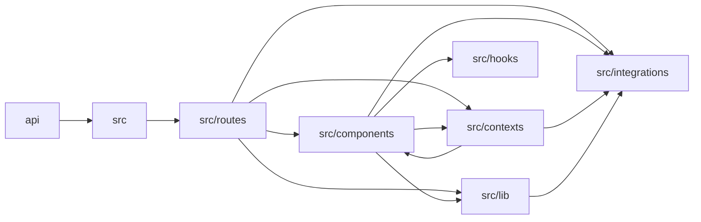

# Architecture

A TanStack Start (Vite + React + Tailwind) football team-management app backed by Supabase. The root config wires Vite/ESLint tooling; `api/ssr.js` adapts Node HTTP to the built Web-standard server for serverless SSR. `src/router.tsx` instantiates TanStack Router from the generated route tree. `src/routes` holds page views (fixtures, squad, stats, fine box, home lineup) plus server routes: an authenticated streaming AI assistant endpoint (`/assistent`, OpenRouter) and an iCalendar feed (`/kalender/$seasonId`). `src/components` contains domain widgets (AttendancePanel, ChatWidget, FixtureCalendar, SeasonPicker) and a shadcn-style Radix/CVA UI kit. `src/contexts` provides Auth and Season providers over Supabase; `src/hooks` provides viewport detection; `src/integrations` holds generated Supabase types, browser/server clients and auth middleware; `src/lib` supplies the AI prompt-context builder, formation logic, ICS generation and the `cn` class helper. AI touchpoints: ChatWidget → /assistent route → assistant-context prompt builder.

## Modules

| module | summary | AI |
| --- | --- | --- |
| `(root)` | Vite (TanStack Start, React, Tailwind, tsconfig paths) and ESLint flat config. | — |
| `api` | Serverless SSR handler bridging Node req/res to the built Web-standard server.fetch. | — |
| `src` | Router instantiation with default error fallback and generated route tree. | — |
| `src/components` | Domain widgets (attendance, AI chat, fixture calendar, season picker) plus shadcn-style Radix UI kit. | — |
| `src/contexts` | Auth and Season React providers/hooks backed by Supabase and localStorage. | — |
| `src/hooks` | useIsMobile viewport breakpoint hook. | — |
| `src/integrations` | Generated Supabase DB types, client/server Supabase clients, auth middleware. | — |
| `src/lib` | Assistant prompt-context builder, formation presets/parsing, ICS generation, cn helper. | [AI] |
| `src/routes` | TanStack Router pages, root layout/providers, and server routes for AI streaming and ICS feed. | [AI] |

## Module dependencies

_`[AI]` marks modules with AI/LLM touchpoints (prompt files, model API calls, agent logic)._
